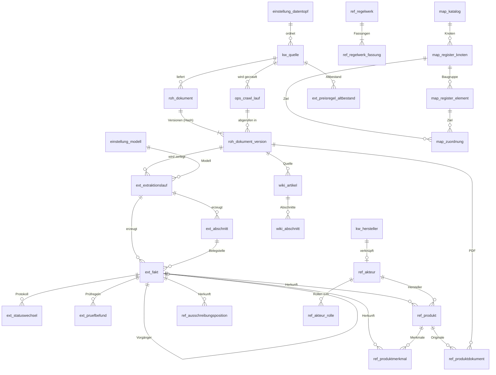

# Datenmodell der Wissens-DB

Stand: 29.10.2026 · Projekt `juluzutgabkiqnoaggxe` · Migrationen in `supabase/migrations/`

## Ablauf in einem Satz

Eine Quelle (`kw.quelle`) wird gecrawlt (`ops.crawl_lauf`). Jede Datei landet versioniert in
`roh.dokument_version`, wird in der Zwischenebene in Abschnitte und Fakten zerlegt (`ext`),
geprüft und freigegeben (`ref`, Kostenkennwerte in `kw`) und dem Register aus cc-core zugeordnet (`map`).

## Schemas

| Schema | Zweck | Wichtigste Tabellen |
| --- | --- | --- |
| `kw` (Bestand) | Kennwert-Katalog, freigegebene Kostenkennwerte; **einziges Quellenregister** | `quelle` (erweitert), `hersteller`, `epa_position`, `meldungstyp_kennwert`, … |
| `einstellung` | Schwellen, Modellwahl, Datentöpfe – ohne Deployment änderbar | `parameter`, `parameter_historie`, `modell`, `datentopf` |
| `ops` | Betrieb | `crawl_lauf`, `fehler`, `tagesbericht`; Sichten `offene_fakten`, `kennzahl_woche` |
| `roh` | Rohdokumente, unveränderlich, versioniert per Hash | `dokument`, `dokument_version` |
| `ext` | Zwischenebene | `extraktionslauf`, `abschnitt` (Embedding), `fakt`, `statuswechsel`, `pruefbefund`, `preisregel_altbestand` |
| `ref` | Freigegebenes Wissen | `akteur`, `akteur_rolle`, `produkt`, `produktmerkmal`, `produktdokument`, `ausschreibungsposition`, `regelwerk`, `regelwerk_fassung` |
| `map` | Register aus cc-core und Zuordnungen | `katalog`, `register_knoten`, `register_element`, `zuordnung`, `klassifikation_mapping` |
| `wiki` | Fachartikel | `artikel`, `abschnitt` (Embedding) |
| `lern` | Lernspeicher ElementScout (+ Sichten/Funktionen in `public`) | `learning_cases`, `qualification_patterns` |

## ER-Diagramm (Kern)

Als Bild: [`datenmodell_er.png`](datenmodell_er.png)

`map.zuordnung` verweist über `ziel_art` + `ziel_id` auf Fakt, Produkt, Ausschreibungsposition,
Abschnitt, Wiki-Artikel oder Lernfall (polymorph, daher ohne Fremdschlüssel auf das Ziel).

## Regeln, die die Datenbank selbst erzwingt

| Regel | Umsetzung |
| --- | --- |
| Nie überschreiben, immer versionieren | Trigger `ops.unveraenderlich` / `ops.nur_spalten_aenderbar`; Fakten nur über `ext.fakt_status_setzen` |
| Keine Zahl ohne Herkunft | `ref.*.herkunft_fakt_id not null` → Fakt → Dokumentversion → URL, Hash, Abrufdatum |
| Änderungserkennung | `roh.version_anlegen`: gleicher Hash = keine neue Version |
| E1 Lizenzquellen | Constraint `quelle_crawl_nur_wenn_erlaubt` auf `kw.quelle` |
| E6 Auto-Freigabe ab 0,80 | `ext.auto_freigabe`, Schwelle in `einstellung.parameter` |
| E13 Kennwerte nie automatisch | Ausnahmeliste `auto_freigabe_ausgenommen`, geprüft in `ext.fakt_status_setzen` |
| Kennwert braucht Bezugsgröße | Constraint `fakt_kennwert_vollstaendig` |
| Codes als Text (GEFMA-Regel 6) | `din276_kg`, `facility_code`, `service_code`, Register-Codes als `text` |
| Regelwerk mit Fassung (GEFMA-Regel 4) | `ref.regelwerk_fassung` |
| Rollen n:m mit Zeitbezug (GEFMA-Regel 5) | `ref.akteur_rolle`, `personenart` getrennt |
| Zugriff | RLS auf allen neuen Tabellen, keine Policies; nur `service_role` mit Schema-Rechten; kein `DELETE` |

## Bewusste Abweichungen vom Briefing

- **Kein eigenes Schema `quelle`:** Quellenregister ist `kw.quelle` (E12). Datentöpfe liegen in `einstellung.datentopf`.
- **Keine Tabelle `ref.kostenkennwert`:** Kostenkennwerte bleiben in `kw` und werden dort von einer Person übernommen (E12, E13).
  Der Crawler legt sie als `ext.fakt` mit `fakttyp = 'kostenkennwert'` ab.
- **Kein `mandant_id`:** Die Wissens-DB ist mandantenunabhängig (Auftrag). Lernfälle tragen nur einen gesalzenen Besucher-Hash.
- **Lernspeicher-Tabellen in `lern`, Zugriff über Sichten in `public`:** Der vorhandene ElementScout-Code nutzt das Schema `public`.
